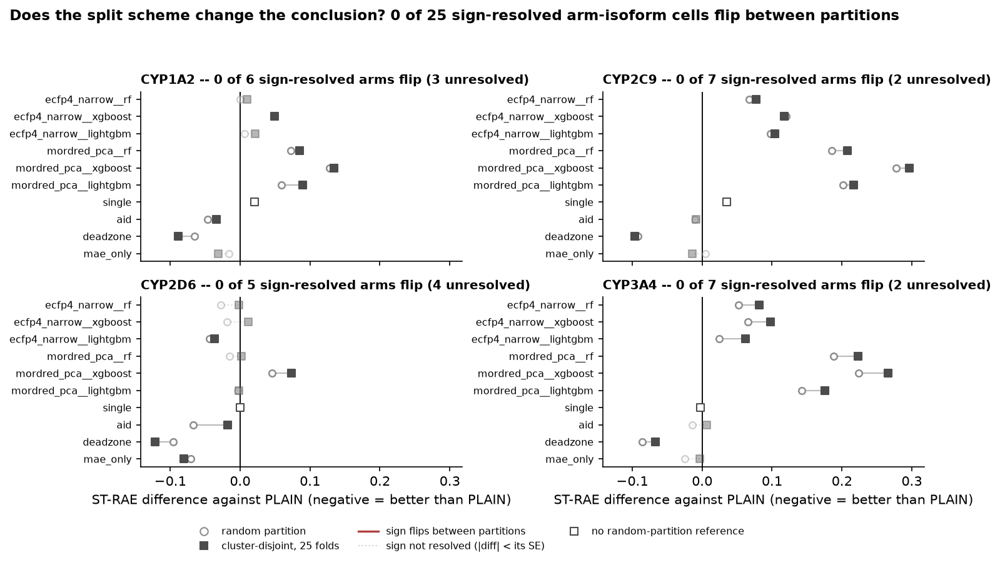
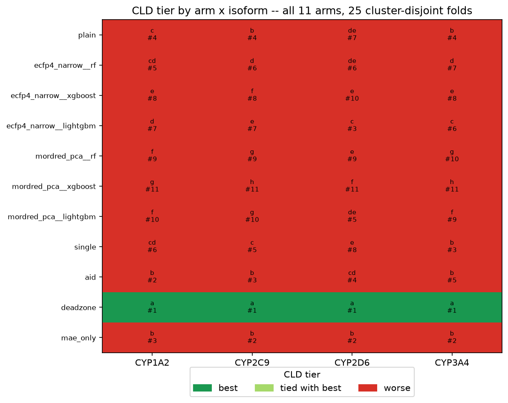
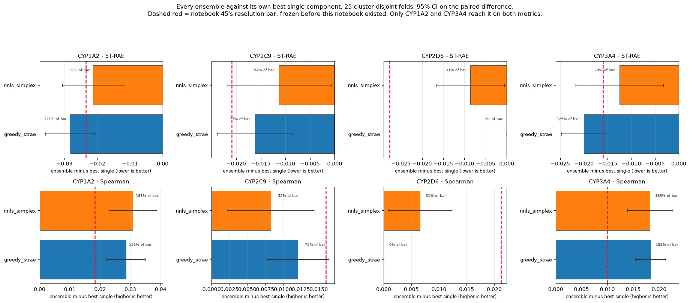
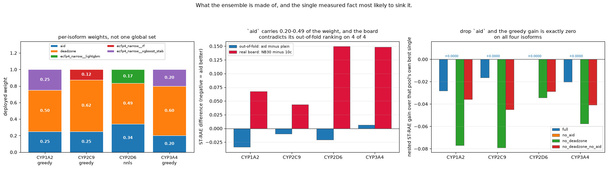

## What this post covers

By the end of the last post I had four occasions where a cross-validated result failed to reach the leaderboard,1 each with stronger CV backing than the last. The common factor I kept coming back to was the split: every one of those decisions had been made on a random partition, and three entrants above me use cluster-disjoint folds.

This post covers building that partition properly, what happened to the result that motivated it, and the two submissions that came out of the work. Every score below is a half-set measurement.

## A split that should have mattered

Pat Walters confirmed on the challenge Discord that CYP3A4's screening set was itself built by Butina clustering,2 at 2048-bit Morgan radius 33 with a Tanimoto distance cutoff of 0.65, pairing each qualifying hit with a random cluster-mate. How a dataset is split materially affects what an evaluation measures,4 and a design that does not resemble how the test set was built can estimate prospective performance badly.5 If the test set was constructed by clustering, a random training split is measuring something the blind set does not ask for.

Notebook 33 built a single cluster-disjoint partition on that recipe. It produced 2,617 clusters over the 4,905 curated compounds, and 78.8% of compounds changed fold membership relative to the frozen random partition, against the roughly 80% two independent partitions would give.

Held-out compounds under the cluster-disjoint scheme sit at a median nearest-neighbour similarity of 0.365 to their own fold's training portion, against 0.438 under the random scheme. The blind set sits at 0.587. So the new partition moves held-out compounds *away* from the blind set's profile, not towards it. The case for using this split is not that it looks more like the real test set.

The AID 1851 auxiliary-head arm against the plain model on both partitions. On the random partition the arm came out ahead on three isoforms of four by sign, significantly so only on CYP2D6. On the Butina partition every isoform changed sign. The real leaderboard agreed with Butina and disagreed with random CV, which looked like evidence that my split decision had been misleading model selection for months.

It was five folds, one partition, one seed per fold.

## Two reasons that answer was wrong

Notebook 34 was supposed to be the confirmation. It found two problems with notebook 33 before it got anywhere near a result.

The first is that the partition itself was not reproducible. Notebook 33 broke ties by lowest fold index; the repeated design breaks them by the repeat's seed. Recomputing the clustering gives the same 2,617 clusters size for size, but the fold assignment does not match: best-case agreement between notebook 33's folds and repeat 0 is 22.4%. Notebook 33's numbers therefore sit on a partition no later notebook ever used.

The second, before training notebook 34 retrains the plain model on the random partition's fold zero and compares against notebook 05's stored score, with a hard stop above 0.03. It came back at 0.0378 and aborted, before any of the 125 planned training units started.

The input CSV was byte-identical to notebook 05's. The chemprop6 command line was identical to notebook 31's. The validation loss was bit-identical for epochs 0 and 1, then diverged at epoch 2. The data and the initialisation were right and the arithmetic was not. The cause was `OMP_NUM_THREADS=1`, inherited from notebook 33's setup cell, which changes the order of floating-point reductions and so the training trajectory. Unset, it reproduced notebook 05 exactly, 0.00000000 on all four isoforms.

Notebook 33 ran under that setting, and it never ran this check, correctly noting that no stored external comparison exists for a brand-new partition. Its own arm-versus-arm comparisons are internally consistent, since both arms ran the same way. Its absolute Butina numbers are not on the same numerical footing as the random-partition numbers, which is the comparison it drew.

## What twenty-five folds said

I ran the design out properly, in three stages: two repeats in notebook 34 (10 folds, 100 training units, 11.42 h), a third in notebook 35 (15 folds), and the last two in notebook 37, reaching the 5 × 5 design Ash et al. specify as the minimum for this kind of comparison.7 Eleven arms, 275 units in total.

Every analysis reports the lower fold count beside the higher one, which is the check that adding folds was not a selection. The largest shift in any arm's mean ST-RAE between 15 and 25 folds is 0.0132.

The flip count:

| Design | Sign-resolved cells | Flips |
|---|---:|---:|
| Notebook 33, 5 folds | 4 | 4 |
| Notebook 34, 10 folds | 25 | 1 |
| Notebook 35, 15 folds | 25 | 0 |
| Notebook 37, 25 folds | 25 | 0 |

The first row is not on the same footing as the rest: notebook 33 compared one arm across four isoforms and applied no resolution rule, where the later rows cover all eleven arms under one. A cell counts as a flip only where both partitions resolve a sign, meaning the absolute mean difference exceeds its own standard error, which is itself a noisier quantity than it looks.8 That rule exists because notebook 34's first apparent flip turned out to be a +0.000019 near-tie in notebook 05's own numbers.

The one flip at ten folds was the AID arm on CYP3A4. At fifteen folds that cell no longer resolves a sign at all.

*Every arm measured twice, once on each partition, with the pair joined so it reads as one object. A pair straddling the zero line would be a sign flip. There are none: 0 of 6 on CYP1A2, 0 of 7 on CYP2C9, 0 of 5 on CYP2D6 and 0 of 7 on CYP3A4, with 11 cells unresolved and the single-task arm carrying no random-partition reference at all.*

Ordering agreement between the two partitions runs 0.99, 0.96, 0.84 and 0.99 by isoform, and the best arm on both partitions is the same arm on all four.

So the split design does not explain the four board failures. The hypothesis was testable and it failed, and the version of it I had believed for a fortnight rested on a partition I could not reproduce and a threading setting that moved the third decimal place.

## The arm that did work

The same runs turned up something I was not looking for.

The dead-zone target, from two posts ago, replaces the training target with `clip(oof_prediction, conf_low, conf_high)` under absolute-error loss, so a compound the model already places inside its own published credible band contributes no gradient. At 25 cluster-disjoint folds it is significantly better than the plain model on all four isoforms, Benjamini-Hochberg corrected,9 improving on every one of the 25 folds on CYP1A2, CYP2C9 and CYP2D6, and on 23 of 25 for CYP3A4.

*Compact letter display, eleven arms by four isoforms. The dead-zone arm holds tier a on all four, and the "tied with best" colour appears nowhere: no other arm shares the top letter on any isoform.*

It is the only arm that does that. The macro ordering puts it at 0.6723, against 0.7331 for the loss-function-only variant, 0.7517 for the AID arm and 0.7654 for the plain model.

The decomposition matters, because the dead-zone arm changes two things at once: the loss function and the target. A loss-only arm isolates the first. At 25 folds the clipping carries 64% of the gain on CYP1A2, 86% on CYP2C9, 34% on CYP2D6 and 95% on CYP3A4. On three of four isoforms the clipping is doing most of the work, and CYP2D6 is the exception in the other direction. That pattern holds at 10, 15 and 25 folds, and it held on the random partition's single-fold screen as well, so it looks like a property of the isoform rather than of the design.

The AID arm, by contrast, resolves against the plain model on one isoform of four at the completed design. It also resolved on one at ten folds, but not the same one: CYP2D6 then, CYP1A2 now.

One other thing came out of the run. The tree models on raw fingerprint and descriptor features are the first genuinely decorrelated arms this project has produced, measured on residuals rather than on raw predictions.10 Mordred11 descriptors reduced by PCA, with XGBoost,12 sit below the error-correlation floor on all four isoforms, where the dead-zone, loss-only and single-task arms all sit above it. They are also substantially worse on their own. Whether that trade is worth anything is the question the rest of this post is about.

## Closing the correction route

Running in parallel with all of this was the correction work, which is where every board gain to date had come from.

Notebook 36 applied a spread widening to notebook 32's submitted columns, with each isoform's target taken from the spread ratio of whichever submitted column holds that isoform's best score, and a 10% relative-gap bar below which nothing is touched. Three isoforms were widened and CYP2D6 was left alone, its column already sitting on target from an earlier correction. It scored macro 0.6270, and all three widened isoforms improved, which was the prediction recorded before sending.

The interesting part is that two of them were treated almost identically and behaved completely differently. CYP2C9 took a 1.1304 multiplier from an 11.5% gap and gained 0.0200. CYP3A4 took 1.1317 from an 11.6% gap and gained 0.0003.

Notebook 38 went after that. Writing R² = 2ρk − k² − b², with k the ratio of prediction spread to population spread and b the standardised bias, following the decomposition another entrant on this challenge set out in their own working notes,13 the blind CYP3A4 population can be fitted by least squares across all eleven submissions on record. Two changes from the earlier solve: Pearson ρ is recovered from the published Spearman through ρ = 2 sin(πρS/6) rather than substituted raw, which was algebraically infeasible on 5 of 11 rows, and no MAE term is used, so there is no residual-normality assumption and no sign ambiguity.

The fit gives a blind CYP3A4 mean of 4.778 and a standard deviation of 1.397, with an RMS residual of 0.0065 on R². It then passed a real out-of-sample test: fitted before notebook 36's submission was scored, it predicted that column's CYP3A4 R² at 0.6515 against a measured 0.6563.

Applied to the 0.0613 gap between my CYP3A4 column and the best on record, the decomposition is 117% correlation and −17% placement, with scale zero by construction. The widened column is *better* centred than the one beating it. A perfect placement correction would recover 0.0051 of R².

That closes the route. Every board improvement this project had made up to that point came from affine corrections, and affine corrections cannot change rank order. On the isoform where I am strongest, rank order is all that is left.

## One object, not four

Which pushed the remaining work towards ensembling, and towards a claim I had been carrying as settled since notebook 35.

That claim was that CYP2D6 cannot be blended. Greedy selection with replacement14 collapsed to a single member on that isoform, at 25 of 25 folds in the completed design, and I had recorded it as a stable property rather than an artefact.

Notebook 39 showed it was an artefact of what the per-isoform search optimises. Comparing three levels of constraint, with the member set and the weights refitted inside each fold and scored on the held-out one:

| Constraint | Nested macro ST-RAE |
|---|---:|
| No blend | 0.7600 |
| Per-isoform members and weights | 0.6529 |
| One shared member set, per-isoform weights | 0.6531 |
| One shared member set and one shared weight vector | **0.6502** |

The most constrained version generalises best, and it wins almost entirely on CYP2D6, which improves by 0.0113 while carrying two members its own per-isoform search rejects at all 25 folds. Read as regularisation, the per-isoform search was overfitting its own folds.

That result also happens to serve a preference I had already stated for its own reasons: I would rather submit one model or one ensemble output than a per-isoform assembly of different models, which is what my best submission is.

## What the board said

Two submissions came out of this stretch.

The first, notebook 47, is the loss-function-only model retrained on all 4,905 compounds. It is the leak-free half of the dead-zone effect, since its targets are the literal curated labels and it carries none of the fold-crosstalk exposure the dead-zone target has. It scored macro 0.6328, and its CYP2C9 column came in at 0.5255, a new best on record, beating the 0.5375 held jointly by four earlier submissions.

The second, notebook 48, is a per-isoform non-negative ensemble fitted on the completed 25-fold design and deployed on full-data blind columns. Before sending it, I measured the blend against its own best single component on resolution bars frozen two days earlier, derived from how well a 25-fold paired comparison on this partition resolves *any* difference rather than the one under test.

*The ensemble against its best single component on both metrics, with the frozen bars marked. Two isoforms clear; two do not.*

CYP1A2 and CYP3A4 cleared on both metrics, at 121% and 125% of the ST-RAE bar and 156% and 183% of the Spearman bar. CYP2C9 and CYP2D6 were significant and under their bars, which on this project's own adoption rule is not an established case.

It scored 0.6356. CYP1A2's Spearman fell 0.0316 and CYP3A4's moved 0.0011. Both isoforms the analysis had resolved as material regressed. CYP2C9, the isoform it had explicitly set aside as unresolvable and left uncorrected, set the highest Spearman on record at 0.7692.

*The fitted weights, and the member the whole gain rests on. Removing the AID arm collapses the greedy blend onto a single member on all four isoforms.*

The reason was written down before the submission went out. The entire measured gain rests on the AID arm: drop that member and the greedy fit collapses onto the dead-zone model alone on all four isoforms, with a gain of exactly zero. The AID arm is also the one member where out-of-fold and board evidence can be compared without a correction in the way, and they disagree, with the board preferring the plain model on all four isoforms by 0.043 to 0.149 ST-RAE. The prediction file carried that counterexample in writing, and it is what bit.

Neither submission beat 27b, which has held at 0.5982 since 19 September.

## Where this leaves things

The month's largest piece of work tested a hypothesis about my own methodology and the hypothesis failed. Zero of twenty-five sign-resolved comparisons flip between the two partitions, the arm ordering agrees at 0.84 to 0.99, and the same arm wins on both. Cluster-disjoint splitting does not change this project's conclusions.

What the apparatus produced instead is a defensible comparison under the protocol the literature specifies, one arm that beats the baseline everywhere under it, and a placement solve that passed an out-of-sample test and then told me the remaining gap on my strongest isoform is ranking, which no correction I have can reach.

The ensemble result is the one I keep going back to. It is the first transfer failure here where the cross-validated effect was material on both metrics rather than merely significant, measured against a bar frozen before the comparison existed, and on the two isoforms it resolved, one regressed and the other did not move. Independent re-evaluations of published ADMET models report the same pattern at field scale.15 Four CV-to-board failures have become five, and this one was the most carefully gated of them.

---

## References

1. OpenADMET CYP Blind Challenge, Hugging Face Space, <https://huggingface.co/spaces/openadmet/cyp-challenge>, (accessed 18 August 2026).
2. D. Butina, Unsupervised Data Base Clustering Based on Daylight's Fingerprint and Tanimoto Similarity: A Fast and Automated Way To Cluster Small and Large Data Sets, *J. Chem. Inf. Comput. Sci.*, 1999, **39**, 747–750.
3. D. Rogers and M. Hahn, Extended-Connectivity Fingerprints, *J. Chem. Inf. Model.*, 2010, **50**, 742–754.
4. J. Simm, L. Humbeck, A. Zalewski, N. Sturm, W. Heyndrickx, Y. Moreau, B. Beck and A. Schuffenhauer, Splitting Chemical Structure Data Sets for Federated Privacy-Preserving Machine Learning, *J. Cheminform.*, 2021, **13**, 96.
5. R. P. Sheridan, Time-Split Cross-Validation as a Method for Estimating the Goodness of Prospective Prediction, *J. Chem. Inf. Model.*, 2013, **53**, 783–790.
6. E. Heid, K. P. Greenman, Y. Chung, S.-C. Li, D. E. Graff, F. H. Vermeire, H. Wu, W. H. Green and C. J. McGill, Chemprop: A Machine Learning Package for Chemical Property Prediction, *J. Chem. Inf. Model.*, 2023, **64**, 9–17.
7. J. R. Ash, C. Wognum, R. Rodríguez-Pérez, M. Aldeghi, A. C. Cheng, D.-A. Clevert, O. Engkvist, C. Fang, D. J. Price, J. M. Hughes-Oliver and W. P. Walters, Practically Significant Method Comparison Protocols for Machine Learning in Small Molecule Drug Discovery, *J. Chem. Inf. Model.*, 2025, **65**, 9398–9411.
8. Y. Bengio and Y. Grandvalet, No Unbiased Estimator of the Variance of K-Fold Cross-Validation, *J. Mach. Learn. Res.*, 2004, **5**, 1089–1105.
9. Y. Benjamini and Y. Hochberg, Controlling the False Discovery Rate: A Practical and Powerful Approach to Multiple Testing, *J. R. Stat. Soc. Series B Stat. Methodol.*, 1995, **57**, 289–300.
10. T. G. Dietterich, Ensemble Methods in Machine Learning, in *Multiple Classifier Systems*, Springer Berlin Heidelberg, Berlin, Heidelberg, 2000, vol. 1857, pp. 1–15.
11. H. Moriwaki, Y.-S. Tian, N. Kawashita and T. Takagi, Mordred: A Molecular Descriptor Calculator, *J. Cheminform.*, 2018, **10**, 4.
12. T. Chen and C. Guestrin, XGBoost: A Scalable Tree Boosting System, in *Proceedings of the 22nd ACM SIGKDD International Conference on Knowledge Discovery and Data Mining*, ACM, San Francisco, California, USA, 2016, pp. 785–794.
13. SuperCowPowers, The CYP Challenge — Working Notes, *ADMET Workbench*, <https://supercowpowers.github.io/workbench/blogs/cyp_challenge/>, (accessed 3 September 2026).
14. R. Caruana, A. Niculescu-Mizil, G. Crew and A. Ksikes, Ensemble Selection from Libraries of Models, in *Twenty-First International Conference on Machine Learning (ICML '04)*, ACM Press, Banff, Alberta, Canada, 2004, p. 18.
15. I. Koleiev, R. Stratiichuk, N. Shevchuk, M. Melnychenko, O. Nyporko, D. Todoryshyn, V. Husak, S. Starosyla, S. Yesylevskyy and A. Nafiiev, Critical Assessment of ML models for ADMET Prediction in TDC leaderboards, *bioRxiv*, 2026, preprint, DOI: 10.64898/2026.02.26.708193.