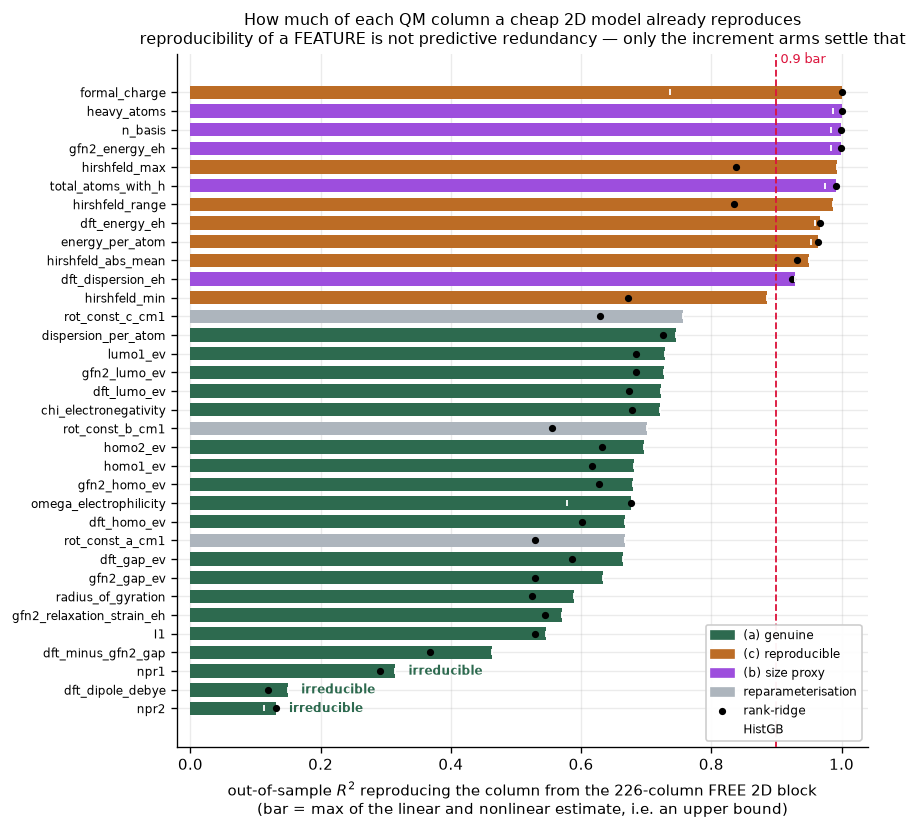
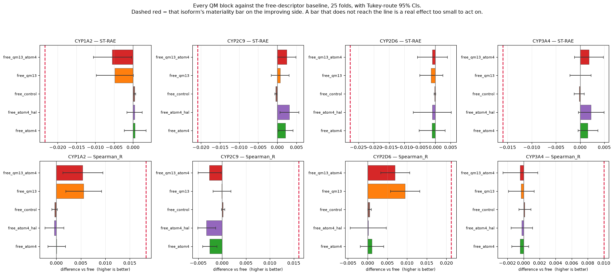
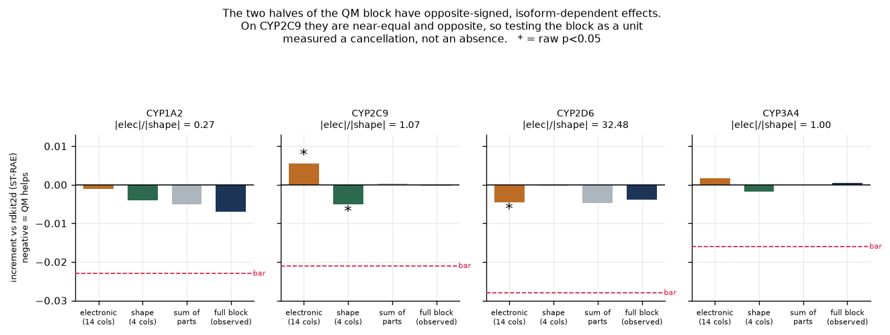
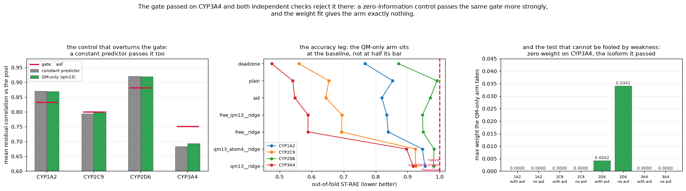
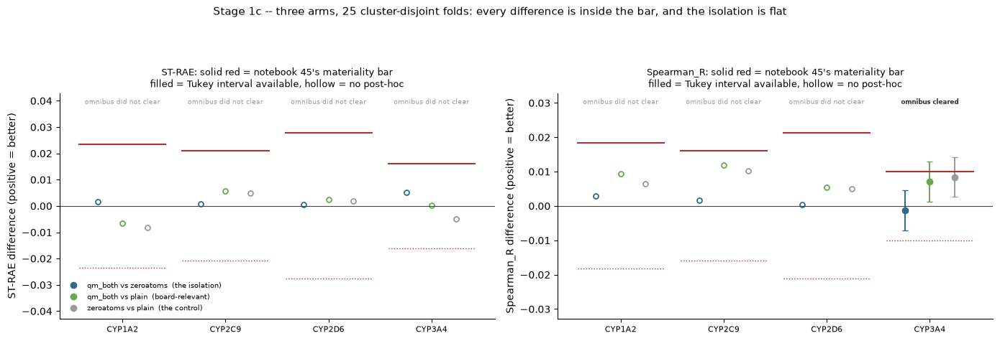

## What this post covers

My supervisor suggested a quantum-chemical descriptor strand, the argument for it is reasonable: a model trained on 2D structure has no access to electron density, and combining cheap quantum chemistry with machine learning has a real literature behind it.1 If frontier orbital energies or partial charges carry anything about CYP inhibition that a fingerprint does not, that is new information rather than a rearrangement of what I already have.

This post covers measuring the cost before committing to it, the full run and the problem it ran into, and then three independent attempts to show the descriptors are worth something: as features in a linear model, as a decorrelated ensemble member and inside the graph network itself. Every score below is a half-set measurement.2

>The short version is that all three failed, and in two of the three the thing that produced the answer was a control I had added almost as an afterthought.

## Measuring the machine instead of assuming it

Notebook 41 replaced the plan's assumptions about the compounds with measurements, using RDKit3 over the SMILES already on disk. Two of the four answers came back differently from what the plan expected.

The size tail is not a problem. Heavy atom count has a median of 24 and a 99th percentile of 34, and exactly 3 of 5,655 compounds sit above 50 heavy atoms. The expensive compounds are a named handful, not a chemotype or an isoform.

Chirality is not merely deferred, it is unavailable. Of the 750 blind compounds, 266 carry at least one stereocentre and only 18 have every centre specified. Among blind compounds that have a centre at all, 93.2% carry an unassigned one. I checked whether my own curation had stripped the information by comparing four separate SMILES sources, from the raw challenge file through to the live featurisation code, and the counts are identical on every one. The information was never there. A chirality descriptor cannot be computed for the great majority of the compounds that are actually scored, so the sensitivity check I had been carrying since August is not pending, it is impossible.

The audit also found two smaller things worth recording. The `logd_proxy` column in my own feature set is bit-identical to `logp` on all 5,655 rows, so a nine-descriptor set has eight distinct values. And `stereocenter_count`, which I had been treating as a count of assigned configurations, counts potential centres whether specified or not.

Notebook 42 then measured the cost on fifteen compounds spanning the size range and the two chemotypes flagged as SCF risks, before committing to the full set. Conformers from RDKit's ETKDG,4 then ORCA5,6 for a GFN2-xTB7 geometry optimisation followed by a B3LYP8,9-D310/def2-SV(P)11 single point.

The timing verdict was that the DFT single point averages 0.57 min at six cores across the population, under the 2-minute bar frozen before any of it ran, so the full set was viable at 166.8 h. The geometry step, not the DFT step, turned out to dominate at 66% of that.

Six fits were compared to decide which size measure predicts cost. Basis function count won on every metric, with the lowest leave-one-out error at 24.8%, and it won 69.9% of bootstrap resamples against a 70.0% bar frozen before any result was seen. The verdict reads NOT RESOLVED, and the notebook states that the bar is not moved to meet it. Nothing downstream would have changed if I had moved it.

The production run then went through: 5,655 compounds, 11,310 ORCA jobs, zero failures.

## The atom that coordinates the iron

The most chemically motivated use of per-atom quantum data is the charge on whichever atom coordinates the haem iron. Notebook 43 tried to find that atom.

It also corrected a premise I had been working from. I had recorded Correia and Hollenberg12 as supporting computation on the neutral species. Read properly, "neutral" there qualifies the enzyme's redox state, ferric against ferrous, not the ligand, and the passage concerns anions. Beck et al.13 point the other way for CYP2D6, describing substrates that procure a positive charge. The decision to compute neutral species stands, because 11,310 jobs rest on it, but its justification changed.

Three nested SMARTS definitions were measured over all 5,655 compounds. The conservative one, aliphatic basic nitrogen only, is the same pattern behind the CYP2D6 descriptor set from Kiani and Jabeen.14 The second adds aromatic nitrogen, which is what the cited chemistry actually describes. The third adds divalent sulfur and hydroxyl oxygen.

| Definition | Compounds matched | CYP2D6 enrichment | Empty on the blind set |
|---|---:|---:|---:|
| Conservative, aliphatic basic N | 17.9% | 2.84× | 88.4% |
| Faithful, plus aromatic N | 79.0% | 1.09× | 23.1% |
| Inclusive, plus S and OH | 84.6% | 1.05× | 18.3% |

That is the bind, and it is not a matter of choosing more carefully between the three. The definition faithful to the chemistry matches four compounds in five and selects an atom in nearly all of them, so it carries almost no information. The definition that selects is empty for 88.4% of the compounds I am actually scored on. Worse for the idea, the mere presence flag of the conservative pattern already carries significant signal on all four isoforms on its own, so a charge column might be paying for something a single binary feature already has.

The atom-level arm was left pre-registered and unrun.

## Detected, not material

The molecule-level question is simpler: do the quantum columns improve prediction over the free 2D descriptors they would sit alongside?

Before testing that, notebook 44 asked how much of each quantum column a cheap 2D model can already reproduce. Most of it, as it turns out.

*How much of each quantum column a 226-descriptor 2D block already predicts, as an upper bound taken from the better of a linear and a nonlinear estimate. Hirshfeld charge summaries sit at 0.89 to 0.99. Only the dipole moment and two 3D shape ratios resist. Reproducibility of a feature is not the same as predictive redundancy, which is what the increment arms exist to settle.*

Notebook 46 then ran the comparison properly: six feature blocks against the free-descriptor baseline on the frozen 25-fold cluster-disjoint partition, under the full Ash protocol15 with the homogeneity branch checked rather than assumed. Five of eight omnibus tests cleared, which routed to Tukey for the first time in this project, since six methods sits under the threshold above which the protocol switches to Benjamini-Hochberg.16

*Every block against the free baseline on both metrics, with each isoform's materiality bar as the dashed red line on the improving side. Six of forty cells reach significance. Not one bar reaches its line.*

Six cells of forty are significant and none is material. The largest is the molecule-level block on CYP2D6 ranking, at 45% of its bar with 22 of 25 folds improving. Five of the six significant cells improve and one harms: the halogen-conditioned atom block costs CYP2C9 ranking, with only 7 of 25 folds better.

The four atom descriptors that notebook 45's screen had recommended come in at 0 of 16 across both contrasts. Not immaterial, not significant at all. Every significant cell in the arm comes from the molecule-level block that notebook 44 had already found immaterial.

One finding did come out of it that nobody was testing for.

*The electronic and shape halves of the block, tested separately against the same baseline. On CYP2C9 they are near-equal and opposite, so testing the block as one unit measured a cancellation rather than an absence. Asterisks mark raw p below 0.05; this comparison is post-hoc and is fenced as such.*

Split in half, the electronic and shape columns do opposite things depending on isoform, and on CYP2C9 they very nearly cancel. The block-level null there was two real effects summing to zero, not an absence of effect. The audit of that notebook pointed out that this comparison, unlike the primaries, was formulated after the block-level null was read and sits in no pre-declared family, so the notebook now carries it fenced as post-hoc and the claim rests on CYP2C9 alone.

## How a bar gets chosen

The bar is doing more work in this post than any single result, and it has now been got wrong once and disputed twice.

The rule is that a materiality bar is twice the mean standard error of a 25-fold paired comparison on this partition, pooled across ten different arms against the plain model. Pooling across arms is the point: it measures how well this design resolves *any* difference, independent of the one being tested. It is never twice the standard error of the comparison under test, because that is approximately the significance threshold restated and carries no information significance did not already give.

The first dispute was arithmetic. Notebook 45 found that the 25 folds live across three notebooks, and that reading them from one gives 10 folds per comparison, inflating every standard error by roughly the square root of 25 over 10.

The second showed how much the choice matters. Notebook 44 had pre-registered a ranking comparison and never run it; the audit ran it late and labelled it as such. Derived from the comparison under test, the bars come out at 0.0012 to 0.0034 and call 7 of 12 cells material. Derived the independent way, they come out 5 to 8 times larger and call none material. Both derivations and the resulting flip are printed in the notebook, because the verdict turns on the choice and a reader is entitled to see it.

The audit also found that the pre-registration file's timestamp post-dates 459 of the 476 prediction files, and that nothing was committed to git, so there is no independent evidence of commit order. Two things limit the damage, and both are checkable: the bars reproduce exactly from a file dated five days before the experiment, which cannot encode its outcome, and refitting arms from the current feature files reproduces the stored predictions to machine epsilon, so the training data is the data that was used. What is not recoverable is the provenance of the criteria text itself, and for a pre-registered negative that is the part a reader most needs.

The same audit established that notebook 44 ran no omnibus test at all, skipping two steps the protocol specifies. Notebook 46 recorded that as a formal disclosure rather than quietly fixing it.

## Two controls

With the feature route closed on accuracy, the remaining argument for the quantum block was diversity. An ensemble member does not need to be accurate if it is wrong in different places, which is the condition that makes averaging work at all.17 My current ensemble's entire gain rests on one member, so a replacement for it would be worth having.

Notebook 49 pre-registered a gate before training: a quantum-only arm passes if its residual correlation against the pool falls below that member's on at least one isoform. It passed, on CYP3A4, both arms.

Then I added a control that was not pre-registered, a constant predictor, and it passed the same gate on two of four isoforms, and on CYP3A4 more strongly than the real arm.

*Left: the gate passed on CYP3A4, and a zero-information control passes it too, more strongly. Centre: the accuracy leg, with the QM-only arms sitting on the naive-baseline line rather than at half their bar. Right: the weight fit gives the arm exactly nothing on the isoform it passed.*

The mechanism is not subtle once it is visible. Residual correlation against a pool is depressed by weakness as much as by orthogonality: a nearly constant arm's residuals are dominated by the negative of the true values, so they correlate poorly with everyone. The quantum-only arms score 0.92 to 0.98 ST-RAE against a naive baseline of exactly 1.0, and their prediction spread runs 0.25 to 0.37 of the training-label spread against board targets of 0.82 to 0.93. They are not accurate-and-diverse. They are inaccurate, and the gate I wrote could not tell the difference.

The notebook reports that as a defect in its own design rather than as a pass. The weight fit, which cannot be fooled the same way, gives the quantum arms zero weight on CYP3A4 in all four configurations tested.

Notebook 52 then ran the one mechanism left. Aggregating 252,237 atom rows into four columns is a lossy summary; feeding per-atom values into the message passing is a different proposition, because the value attaches to the atom and travels to its neighbours. That route has real precedent for quantum features in graph networks.18

Getting there took three obstacles. CheMeleon refuses per-atom features outright in Chemprop19 2.3.1,20 established from the source, from the checkpoint shapes and from a CLI call that exits 1. The way through was a local foundation file carrying CheMeleon's own weights widened by columns of zeros, which reproduces it exactly at initialisation. Taking that route then exposed a genuine upstream defect: on the foundation path Chemprop fits and logs the atom-feature scaler but never attaches the transform, while the dataset normalises its arrays in place, so training sees scaled features and prediction sees unscaled ones, silently, on every blind prediction. And the quantum run featurised raw SMILES while Chemprop is given canonical SMILES, so the atom orderings differ on 1,543 of 5,655 compounds and had to be mapped explicitly, with a negative control that bites on all 50 probes.

The design was three arms: the plain model, the model with quantum features, and the same model with the atom array zeroed. The zeros control is the sharper test, because dropping the flag entirely would also change the encoder and the command line.

*Three arms at 25 folds. The isolation comparison, real atom values against zeros, is the blue point in each panel. Every difference sits inside the bar, and only one omnibus cleared at all.*

The primary comparison is significant on 0 of 8 cells and material on 0 of 8. In the single cell whose omnibus cleared, the two arms share a compact-letter-display letter at p = 0.83.

The attribution then runs backwards for the hypothesis. The zeros control is *more* significant against the plain model than the real arm is, at 84% of bar against 71%. Whatever small ranking gain exists on CYP3A4 comes from the thirteen molecule-level descriptors and the model load path, not from the per-atom values. That is only visible because the control ran at the same power as the arm.

One ceiling this cannot speak past: Chemprop carries no explicit hydrogens, so 45% of the quantum atom rows never reach the graph at all. A third column was added specifically to recover the largest identified casualty of that, reproducing the per-molecule hydrogen summary exactly, and it changed nothing.

## The experiment that is still waiting

One test remains built and unsent. Notebooks 50 and 51 are a matched pair: ridge on 226 free descriptors against ridge on those same 226 plus 17 quantum columns, where the feature block is the only difference. Both call one function in one script, and the second asserts its pipeline against the first's recorded fingerprint field by field.

The part I like is what the correction chain does to the comparison. Both files get the same placement and widening procedure, which forces three of four isoforms to identical spread and CYP2D6 to an identical mean. On those three the two submissions can differ only in rank order, which is the quantity that separates the leading columns on this leaderboard and the one no affine correction can reach. Spread is designed out rather than controlled for afterwards.

Its limits are recorded too. Notebook 46 put the largest quantum effect at 24% of bar on error and 45% on ranking, and a single pair of board readings has no error bar, so the pair can detect a large difference and cannot resolve a small one. The expected macro was written down as 0.62 to 0.85 and explicitly not expected to beat the current best of 0.5982.

Neither has been sent, because the submission endpoint in both notebooks is stale: the host does not exist and the parameter set is out of date, which a later notebook found when its own gate was opened for the first time.

## Where this leaves things

Three ways of asking, three failures, and the two that produced the clearest answers were decided by controls rather than by the arms.

What the quantum data did buy is real but smaller than 281 core-hours sounds. A methods result on cost, where the cheap level of theory and the expensive one sit at naive-predictor level standalone and disagree by isoform rather than uniformly. A cancellation finding, where testing a block as one unit measured two opposing effects summing to zero. A chemistry bind stated precisely enough to be useful to someone else: the definition faithful to the coordination chemistry cannot work as a feature, and the one that works is narrower than the chemistry supports.

And a rule I now trust more than I did, which is that a bar has to come from the design's own noise rather than from the comparison being tested. Getting that wrong once, and watching the verdict flip on 7 of 12 cells depending on which derivation I used, was worth more than the descriptors were.

None of this says the quantum data is uninformative in principle. It says that on 4,905 compounds, against a 226-column 2D block, through three different mechanisms, it does not convert into accuracy or ranking that clears the resolution of the design measuring it. Independent re-evaluations of published ADMET models report plenty of effects that do not survive contact with a held-out set,21 and this is one more, caught before it was submitted rather than after.

---

## References

1. R. Ramakrishnan, P. O. Dral, M. Rupp and O. A. Von Lilienfeld, Big Data Meets Quantum Chemistry Approximations: The Δ-Machine Learning Approach, *J. Chem. Theory Comput.*, 2015, **11**, 2087–2096.
2. OpenADMET CYP Blind Challenge, Hugging Face Space, <https://huggingface.co/spaces/openadmet/cyp-challenge>, (accessed 18 August 2026).
3. RDKit: Open-Source Cheminformatics, Release 2026.03.3, Zenodo, 2026, DOI: 10.5281/ZENODO.20446949.
4. S. Riniker and G. A. Landrum, Better Informed Distance Geometry: Using What We Know To Improve Conformation Generation, *J. Chem. Inf. Model.*, 2015, **55**, 2562–2574.
5. F. Neese, The ORCA Program System, *WIREs Comput. Mol. Sci.*, 2012, **2**, 73–78.
6. F. Neese, Software Update: The ORCA Program System, Version 6.0, *WIREs Comput. Mol. Sci.*, 2025, **15**, e70019.
7. C. Bannwarth, S. Ehlert and S. Grimme, GFN2-xTB: An Accurate and Broadly Parametrized Self-Consistent Tight-Binding Quantum Chemical Method with Multipole Electrostatics and Density-Dependent Dispersion Contributions, *J. Chem. Theory Comput.*, 2019, **15**, 1652–1671.
8. A. D. Becke, Density-Functional Thermochemistry. III. The Role of Exact Exchange, *J. Chem. Phys.*, 1993, **98**, 5648–5652.
9. C. Lee, W. Yang and R. G. Parr, Development of the Colle-Salvetti Correlation-Energy Formula into a Functional of the Electron Density, *Phys. Rev. B*, 1988, **37**, 785–789.
10. S. Grimme, J. Antony, S. Ehrlich and H. Krieg, A Consistent and Accurate *Ab Initio* Parametrization of Density Functional Dispersion Correction (DFT-D) for the 94 Elements H-Pu, *J. Chem. Phys.*, 2010, **132**, 154104.
11. F. Weigend and R. Ahlrichs, Balanced Basis Sets of Split Valence, Triple Zeta Valence and Quadruple Zeta Valence Quality for H to Rn: Design and Assessment of Accuracy, *Phys. Chem. Chem. Phys.*, 2005, **7**, 3297.
12. M. A. Correia and P. F. Hollenberg, Inhibition of Cytochrome P450 Enzymes, in *Cytochrome P450*, ed. P. R. Ortiz De Montellano, Springer International Publishing, Cham, 2015, pp. 177–259.
13. T. C. Beck, K. R. Beck, J. Morningstar, M. M. Benjamin and R. A. Norris, Descriptors of Cytochrome Inhibitors and Useful Machine Learning Based Methods for the Design of Safer Drugs, *Pharmaceuticals (Basel)*, 2021, **14**, 472.
14. Y. S. Kiani and I. Jabeen, Exploring the Chemical Space of Cytochrome P450 Inhibitors Using Integrated Physicochemical Parameters, Drug Efficiency Metrics and Decision Tree Models, *Computation*, 2019, **7**, 26.
15. J. R. Ash, C. Wognum, R. Rodríguez-Pérez, M. Aldeghi, A. C. Cheng, D.-A. Clevert, O. Engkvist, C. Fang, D. J. Price, J. M. Hughes-Oliver and W. P. Walters, Practically Significant Method Comparison Protocols for Machine Learning in Small Molecule Drug Discovery, *J. Chem. Inf. Model.*, 2025, **65**, 9398–9411.
16. Y. Benjamini and Y. Hochberg, Controlling the False Discovery Rate: A Practical and Powerful Approach to Multiple Testing, *J. R. Stat. Soc. Series B Stat. Methodol.*, 1995, **57**, 289–300.
17. T. G. Dietterich, Ensemble Methods in Machine Learning, in *Multiple Classifier Systems*, Springer Berlin Heidelberg, Berlin, Heidelberg, 2000, vol. 1857, pp. 1–15.
18. S. Vargas, W. Gee and A. Alexandrova, High-Throughput Quantum Theory of Atoms in Molecules (QTAIM) for Geometric Deep Learning of Molecular and Reaction Properties, *Digital Discovery*, 2024, **3**, 987–998.
19. E. Heid, K. P. Greenman, Y. Chung, S.-C. Li, D. E. Graff, F. H. Vermeire, H. Wu, W. H. Green and C. J. McGill, Chemprop: A Machine Learning Package for Chemical Property Prediction, *J. Chem. Inf. Model.*, 2023, **64**, 9–17.
20. J. W. Burns, A. S. Zalte, C. R. A. Abreu, J. Sieg, C. Feldmann, M. Mathea and W. H. Green, Deep Learning Foundation Models from Classical Molecular Descriptors, *arXiv*, 2026, preprint, arXiv:2506.15792, DOI: 10.48550/arXiv.2506.15792.
21. I. Koleiev, R. Stratiichuk, N. Shevchuk, M. Melnychenko, O. Nyporko, D. Todoryshyn, V. Husak, S. Starosyla, S. Yesylevskyy and A. Nafiiev, Critical Assessment of ML models for ADMET Prediction in TDC leaderboards, *bioRxiv*, 2026, preprint, DOI: 10.64898/2026.02.26.708193.